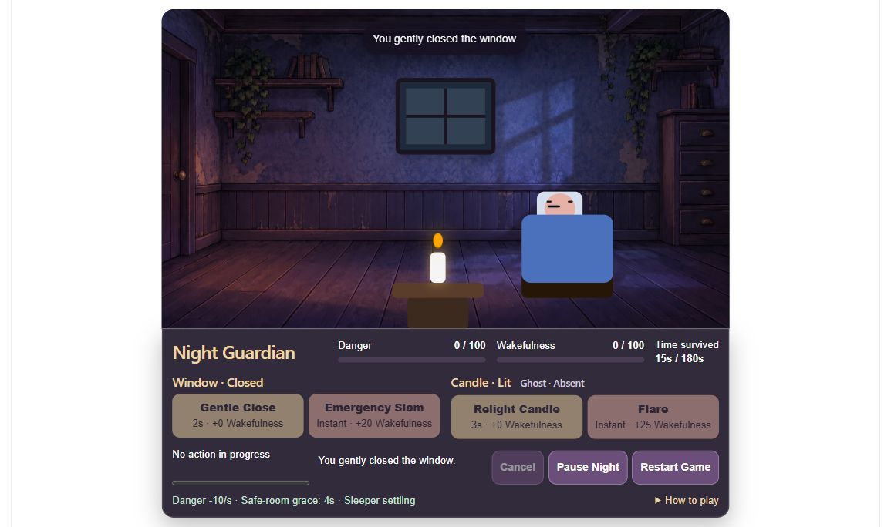
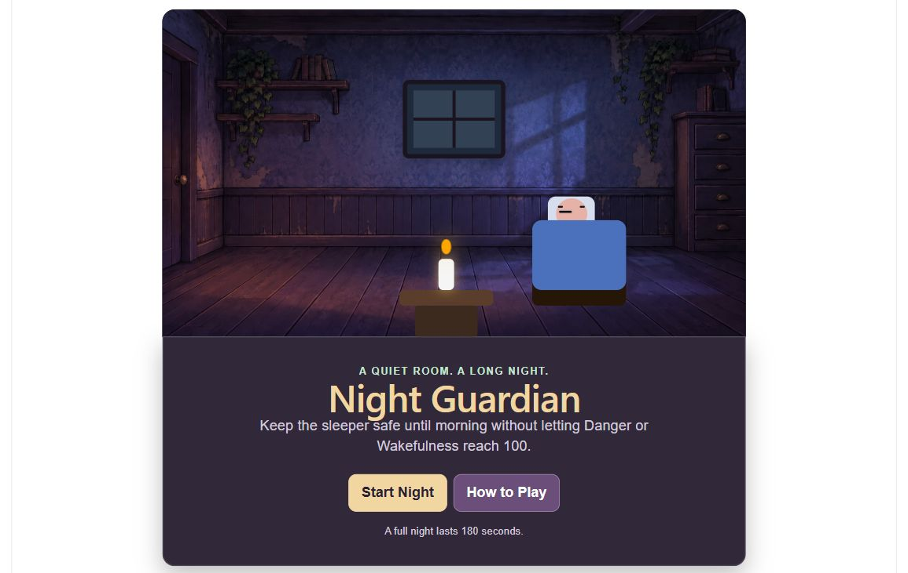
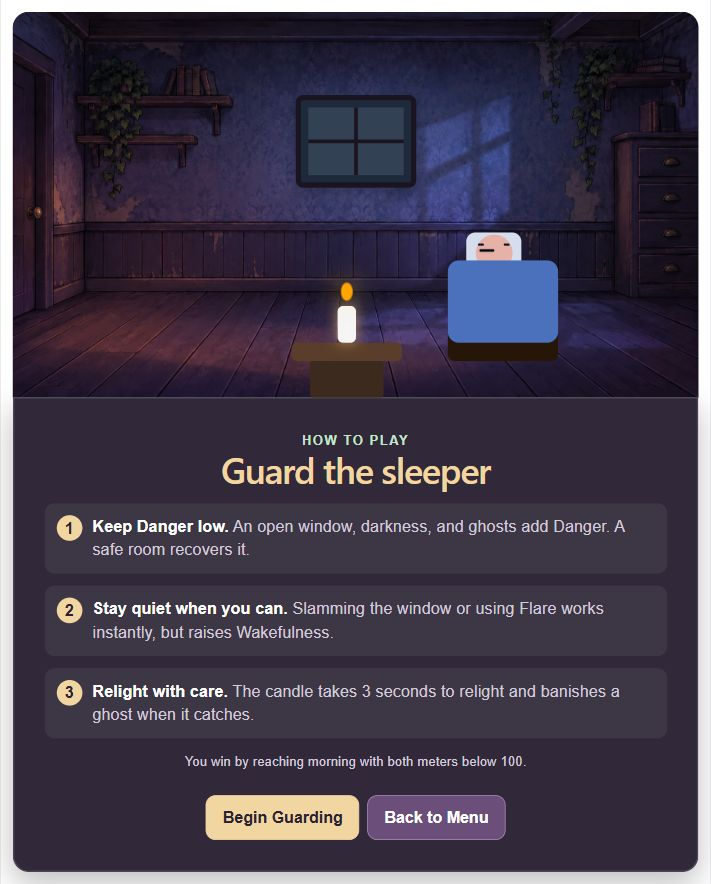
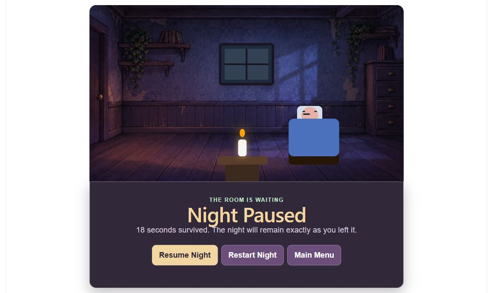
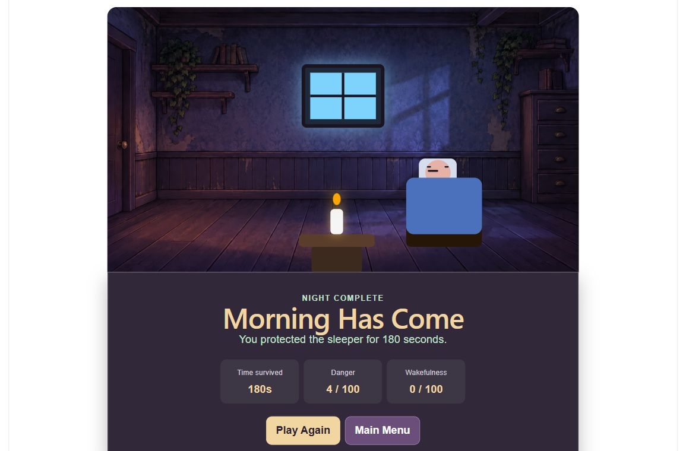
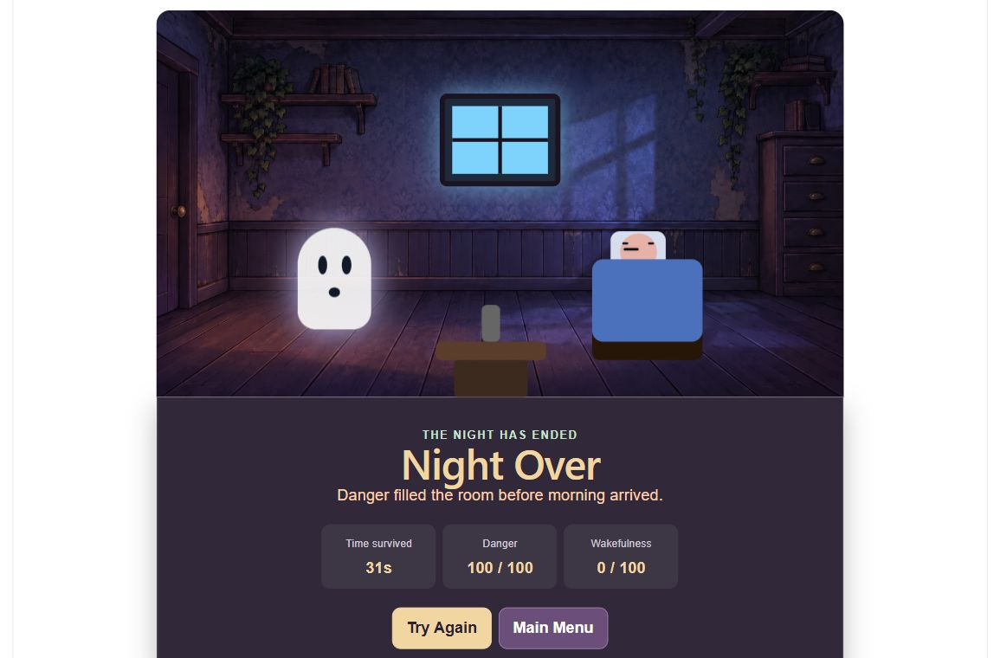

# Night Guardian

Night Guardian is a cozy-horror browser game about protecting a sleeping person until morning without frightening them awake. During a 180-second night, the player manages an opening window, a candle that can be extinguished, and the shadowy ghost that follows prolonged darkness. The central choice is whether to respond quietly and risk losing time, or act immediately and raise the sleeper's Wakefulness.



## What's new in the current milestone

This section compares the current working implementation with the last pushed commit on `origin/main`, [`1f1e4c7`](https://github.com/Farana-Naz-Tultul/night-guardian/commit/1f1e4c73f2e8eb6486013f1e731dd680f9c80779) (`update README with room layout screenshot and current features`). That published version already included the illustrated room, window/candle/ghost threats, a Danger meter, a basic survive-or-lose loop, restart, animations, and an interactive control panel.

The current milestone adds:

- a 180-second night and a separate Wakefulness meter with its own loss condition;
- quiet, sustained actions versus instant, disruptive actions for both the window and candle;
- one cancellable action slot, visible progress, and protection against duplicate clicks or stale completions;
- deadline-driven window, draft, and darkness events with recovery windows and centralized balance values;
- a main menu, three-step tutorial, pause/resume, restart, return-to-menu, and distinct victory/Danger/Wakefulness result screens;
- a component-based scene and HUD backed by a pure reducer and one gameplay clock; and
- 50 deterministic gameplay tests using Node's built-in test runner.

## Gameplay

Survive for 180 seconds while keeping both meters below 100:

- **Danger** rises while the window is open, the candle is out, or a ghost is present. It falls when the room is fully safe: window closed, candle lit, and no ghost.
- **Wakefulness** rises when the player uses an Emergency Slam or Flare. It starts recovering after three uninterrupted calm seconds. A calm moment means the room is fully safe **and** no sustained action is running.
- **Window events** expose the room to Danger and make drafts more likely. Gentle Close takes two seconds and is silent; Emergency Slam is immediate but adds 20 Wakefulness.
- **Candle and ghost events** are one connected threat. A draft can extinguish the candle. After two seconds of darkness, repeated checks can manifest the existing ghost. Relight Candle takes three seconds and its restored flame banishes that ghost; when a ghost is present, Flare lights the candle and banishes it immediately for 25 Wakefulness. There is no separate free instant ghost-removal action.
- **Sustained actions** continue alongside the night clock and Danger. Starting another sustained action cancels unfinished progress. A newly appearing ghost can interrupt the first Relight attempt in that encounter, after which the player must deliberately start Relight again.

### Controls

All current controls are native on-screen buttons. They can be activated by pointer or keyboard; touch-device behavior still needs physical-device verification.

| Control | Effect |
| --- | --- |
| **Gentle Close** | Closes an open window after 2 seconds; adds no Wakefulness. |
| **Emergency Slam** | Closes an open window immediately; adds 20 Wakefulness. |
| **Relight Candle** | Restores an extinguished candle after 3 seconds and banishes the current ghost; adds no Wakefulness. |
| **Flare** | When a ghost is present, immediately lights the candle and banishes it; adds 25 Wakefulness. |
| **Cancel** | Stops the current sustained action and discards its progress. |
| **Pause Night** | Freezes gameplay time, threats, meters, schedules, and action progress. |
| **Restart Game** | Starts a fresh night with both meters, threats, schedules, and action progress reset. |

### Game flow

1. **Main menu:** start immediately or open the short How to Play guide.
2. **Tutorial:** review the Danger, Wakefulness, and candle rules, then begin or return to the menu.
3. **Active night:** watch both meters, respond to threats, cancel or switch sustained actions, pause, or restart.
4. **Pause:** resume the exact frozen state, restart the night, or return to the main menu.
5. **Result:** morning, Danger loss, and Wakefulness loss each have clear copy, a run summary, and Play Again/Try Again and Main Menu choices.

## Architecture

The project remains a React + Vite application and keeps gameplay state in one place:

- [`src/components/Game.jsx`](./src/components/Game.jsx) owns the presentation screen (`menu`, `tutorial`, `playing`, or `paused`), the gameplay reducer, and the single monotonic 100 ms clock.
- [`src/game/gameState.js`](./src/game/gameState.js) is a pure reducer that advances meters, action progress, ordered event deadlines, win/loss transitions, and restart protection. Random samples arrive as event data, which keeps reducer tests deterministic.
- [`src/game/balance.js`](./src/game/balance.js) centralizes provisional durations, costs, rates, probabilities, and recovery windows.
- [`src/components/Room.jsx`](./src/components/Room.jsx) composes the existing `Window`, `Candle`, `Ghost`, and `Sleeper` scene components while preserving the illustrated room and responsive scaling.
- [`src/components/HUD.jsx`](./src/components/HUD.jsx) renders meters, controls, progress, event feedback, and the in-game rules reference.
- [`src/components/GameScreen.jsx`](./src/components/GameScreen.jsx) contains the main menu, tutorial, pause, and result views.

The clock stops when the game is paused or reaches a terminal state. Restart creates a new run ID, and the reducer rejects events from an earlier run, so cancelled or previous-night work cannot complete later.

## Technology

- React 19 and React DOM 19
- JavaScript and JSX
- CSS, including responsive layout and reduced-motion support
- Vite 8
- ESLint 9
- Node.js built-in test runner (`node --test`)

## Run locally

Node.js and npm are required.

```bash
git clone https://github.com/Farana-Naz-Tultul/night-guardian.git
cd night-guardian
npm install
npm run dev
```

Vite prints the local development URL after startup.

### Available commands

These commands match the scripts currently defined in `package.json`:

| Command | Purpose |
| --- | --- |
| `npm run dev` | Start the Vite development server. |
| `npm test` | Run the deterministic gameplay tests. |
| `npm run lint` | Check the project with ESLint. |
| `npm run build` | Create a production build in `dist/`. |
| `npm run preview` | Serve the production build locally for review. |

## Verification

The current reducer suite contains 50 tests covering meter rates and thresholds, both loss reasons, action completion and cancellation, repeated clicks, event ordering, ghost/Relight behavior, recovery windows, restart/run-ID guards, the 180-second win, and seeded full-night simulations. The current checkpoint has also been checked with ESLint and a production build; detailed manual, automated, and still-unperformed checks are recorded in [`PROJECT_LOG.md`](./PROJECT_LOG.md).

The tests focus on reducer behavior. They do not currently mount React components or replace cross-browser, accessibility, touch-device, or human difficulty testing.

## Current game screenshots

These screenshots were captured from the current running game and show the complete presentation flow.

| Main menu | Tutorial / How to Play |
| --- | --- |
|  |  |
| Start a night or open the tutorial. | Review the core rules before guarding the sleeper. |

| Active gameplay | Pause screen |
| --- | --- |
|  |  |
| Track both meters and respond to room threats from the joined HUD. | Resume the frozen night, restart, or return to the main menu. |

| Victory | Defeat / Game Over |
| --- | --- |
|  |  |
| Morning arrives after a full 180-second survival run. | The run ends when Danger reaches 100 before morning. |

A hosted public demo is not currently configured.

## Current limitations

- Balance values are provisional and need broader human playtesting.
- Runs exist only in memory; refreshing the page resets the current night.
- There is no backend, account system, cross-device save, statistics, or achievement system. All current play is local and anonymous, with no explicit guest/account flow.
- Automated coverage is concentrated on the reducer rather than mounted React UI and browser effects.
- Physical touch devices, Firefox/Safari, full keyboard and screen-reader use, browser zoom, and background-tab throttling have not been comprehensively verified.

## Future plans — not implemented

Potential later milestones include account registration/sign-in/sign-out, persistent completed runs across devices, personal statistics and best times, achievements, and a guest/account choice. Further game expansion could add progression or additional nights only after the current core loop and accessibility are validated. None of those features are part of the current implementation.

## Project history

Night Guardian began as a compact, monolithic room prototype and is being improved in reviewable milestones. The current work preserves the original scene and threat concept while separating presentation, gameplay rules, tuning, and tests. See [`PROJECT_LOG.md`](./PROJECT_LOG.md) for the implementation checkpoints and verification record.

## Author

Farana Naz Tultul
